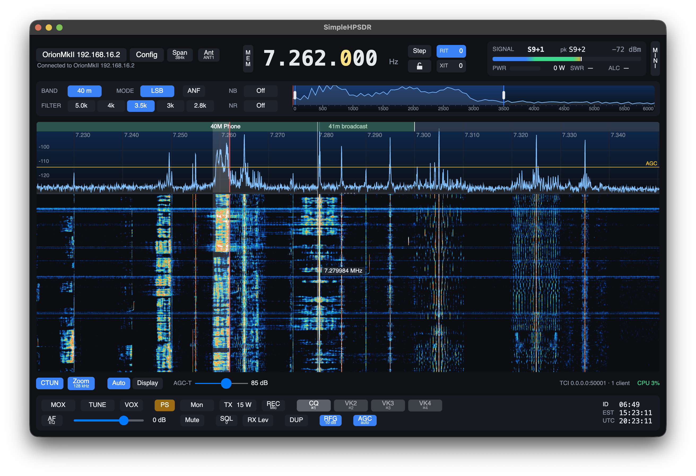
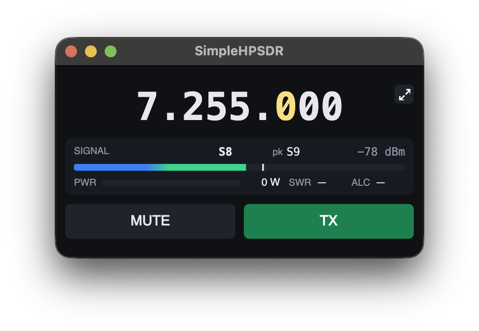
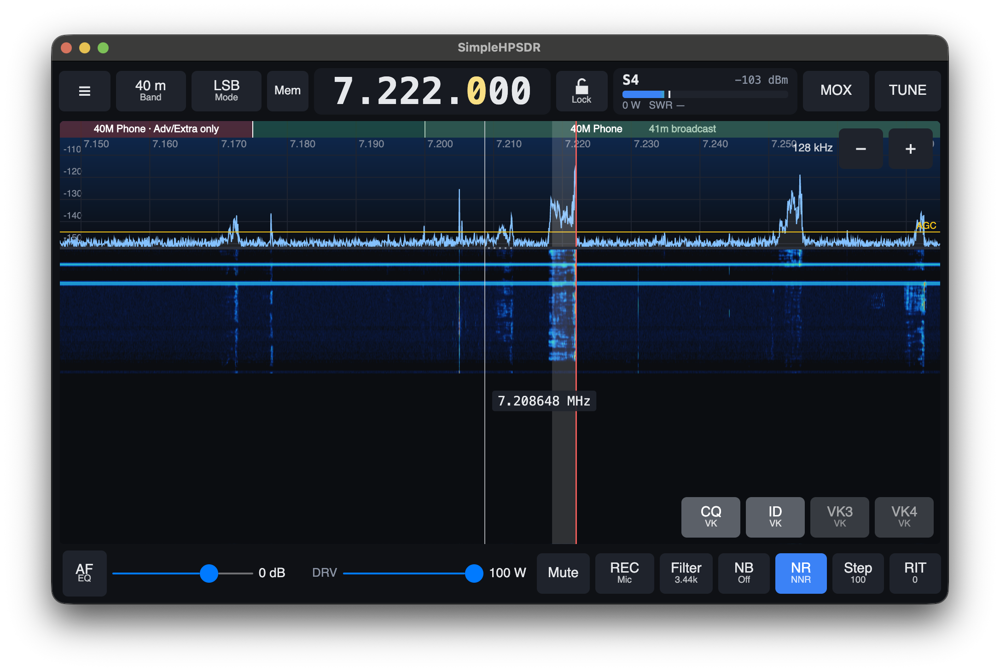

# SimpleHPSDR

A clean, simple interface for OpenHPSDR radios, my intention for this project
is "it's a radio". 

The everyday controls stay on screen and
the rest is a click or right-click away. As lean and clean an interface as
possible but allowing for all the functions of the supported hardware.

This radio has a TCI server so any loggers or digital mode software you choose
should integrate well. I have no intentions to integrate non radio functions into
this project.



A lot of work has gone into reducing TX/RX latency in the turnover times, 
improving Pure Signal lock speed and function as well.

Developed on an ANAN 7000DLE MkII over Protocol 2. It also supports ANAN G2s
(including on the G2's own Pi), Hermes-Lite 2s and Brick SDRs. macOS and Linux
packages are available, and for Windows x64 an installer or a zip, with ASIO under Config > Audio.

Not affiliated with or endorsed by the Zeus SDR project.

## Features

- **Panadapter and waterfall:** drag to recentre, a zoom slider, an adjustable
  split between spectrum and waterfall, POP waterfall contrast, and a frequency
  readout that follows the pointer. Config > Colors picks the spectrum and
  waterfall colours.
- **Band strip:** along the top of the spectrum, from your band plan: green where
  your licence lets you transmit, red where it doesn't, grey for broadcast bands,
  CB and WWV.
- **Filter close-up:** 0 to 6000 Hz of received audio with draggable filter edges.
- **Two slices:** on one panadapter or each with its own, including cross-band
  and split. With two slices on, the AF slider becomes an A and a B slider.
- **Band and mode memory:** each pair, such as 40 m DIGU, keeps its own
  frequency, filter, AGC, drive, mic gain and noise settings.
- **Memories:** 16 under Mem, the same on every band, plus each band's own
  saved frequencies on a right-click of the band button.
- **Noise control:** NB1 and NB2, NR1 to NR4 and neural NNR, with their settings
  on right-click.
- **Receive:** a ten-band receive EQ on the AF button, adaptive squelch, the RX
  leveler, and preamp and attenuator steps with automatic attenuation.
- **Transmit:** PureSignal with one-button calibration and an IMD readout on
  two-tone, CFC, leveler, EQ, phase rotator, monitor and TX audio profiles.
- **Recorder and voice keyer:** REC, beside TX, records what you hear or your
  microphone, plays it back on the speakers or on the air, and four voice keyer
  buttons (also on the touch layout) each send a recording.
- **CW:** keyer settings, a CW window for sending from the keyboard with macros,
  and a decoder that shows the signal as text.
- **FreeDV RADE** digital voice, with your callsign sent at the end of each
  transmission and its squelch, mic and level settings on a right-click.
- **DRM** shortwave broadcasts, through the SimpleDream decoder.
- **Antenna analyser:** sweeps SWR across a band with the radio's own bridge
  at low power, a Hermes-Lite 2's built-in analyser or a NanoVNA.
- **Station:** CAT, TCI, antennas, band outputs, PA calibration, transverters,
  amplifier timing, the Hermes-Lite 2 and its N2ADR IO board, a Palstar HF-AUTO
  tuner's status, and backup and restore of all settings.
- **Clock and ID timer:** local time and UTC, and a reminder to give your call
  every ten minutes.
- **SWL:** starts in SAM with a station guide from EiBi, in your local time. Click a
  station to tune it.
- **Firmware loader** for Protocol 2 radios.
- **Two arrangements:** the controls above and below the panadapter, or all of
  them in a panel at its side so the panadapter gets the window's full height.
  The view button under the panadapter steps between them and the mini window.
- **Amp button:** says whether your amplifier is in line. On, Drive and Tune
  stop at the maximums you set for it; off, the radio runs to full power. Each
  keeps its own remembered levels, per band and per mode.
- **Mini window:** the view button under the panadapter (third click, or its right-click) shrinks
  SimpleHPSDR to the frequency, the meters, Mute and a TX button that transmits
  while held down. The arrows in its corner bring the full window back.
- **Light and dark themes**, following the system.

Most controls have more behind a right-click. See **Help** in the menu.



## Install

Download a package from [Releases](https://github.com/kingsqueak/SimpleHPSDR/releases).

**macOS 14 or later:** open the DMG and drag SimpleHPSDR to Applications. The app
isn't signed by Apple, so the first time, run:

```sh
xattr -dr com.apple.quarantine /Applications/SimpleHPSDR.app
```

**Linux (x86-64 and arm64):**

```sh
sudo apt install ./simplehpsdr_*.deb        # Ubuntu 26.04, Debian
sudo dnf install ./simplehpsdr-*.rpm        # Fedora
sudo pacman -U ./simplehpsdr-*.pkg.tar.zst  # Arch
```

**Raspberry Pi OS Trixie or Bookworm (and Debian 13 or 12):** use the 64-bit
Raspberry Pi OS on a Pi 4 or Pi 5 (or a CM4 / CM5); the 32-bit edition can't run it. Download the `arm64` .deb from the
latest release (on a PC with x86-64 Debian 13, the `amd64` one), then in a terminal:

```sh
cd ~/Downloads
sudo apt update
sudo apt install ./simplehpsdr_*_arm64.deb
```

apt fetches anything else it needs. SimpleHPSDR is then in the applications menu
(or run `simplehpsdr`). To update, install the new .deb the same way; to
remove it, `sudo apt remove simplehpsdr`. Each release's debs are installed and
started on Debian 13 in CI. The first-start tuning below takes much longer on a
Pi than on a desktop computer, so leave it running.

**Windows 10 or 11 (x64), preview:** run `SimpleHPSDR-<version>-win-x64-setup.exe`.
It installs for you alone, with no administrator password, and adds SimpleHPSDR to
the Start menu and to Settings > Apps for uninstalling; for a new version, run its
setup. Or unzip the `.zip` anywhere you can write to and run `SimpleHPSDR.exe`.
The .NET and Visual C++ runtimes are included either way. Settings are kept in
`%LOCALAPPDATA%\SimpleHPSDR`, so they carry over to new versions and stay if you
uninstall. The app isn't signed, so SmartScreen warns the first time:
choose More info, then Run anyway. If Windows Firewall asks about
`StationEngine.exe`, or asks to let it change your device, say yes, or the radio
won't be found. The rule is SimpleHPSDR's own, so Zeus on the same computer keeps
its rule. The radio picker's Network help button gives the command to add it by
hand, and if the picker finds nothing, it offers to add the rule again when none
exists.
To use ASIO, install your audio interface's driver, then pick ASIO under
Config > Audio. The driver must be able to run at 48 kHz. Fewer people use the
Windows build than the others, so please report what you find.

On macOS, allow SimpleHPSDR when it asks to find devices on your local network.

The first start takes a while. The signal processing is measured and tuned for your
computer, which takes around 8 minutes on a fast machine and longer on an older one.
A window shows the progress. Leave the app open until it finishes; this only happens
again after some updates. SimpleHPSDR needs nothing from Zeus; everything it uses is
in the package.

Then choose your radio. Several radios report the same ID, so pick your model in
the radio picker or in Config > Radio. It sets the S-meter calibration and the PA
and PureSignal defaults.

## Small touch screens

On a screen narrower than 1080 pixels, such as the 1024x600 front panel of
some radios, SimpleHPSDR switches to a layout with large buttons and opens
full screen. Config > Radio > Layout picks Automatic, Desktop or Touch;
`simplehpsdr --touch` or `--desktop` overrides it for one run. Everything in
it works with a mouse as well as a finger, and a long press does what a
right-click does.



To start it when a Raspberry Pi desktop logs in, create
`~/.config/autostart/simplehpsdr.desktop`:

```ini
[Desktop Entry]
Type=Application
Name=SimpleHPSDR
Exec=simplehpsdr
```

(Raspberry Pi OS also runs `~/.config/labwc/autostart`; a line `simplehpsdr &`
there does the same.) The touch layout has been tried with a mouse so far, and
the autostart steps aren't tested on a Pi yet; reports from touch-screen users
are welcome.

**On an ANAN G2's own Pi** (CM4 or CM5, with its built-in screen and front
panel), SimpleHPSDR runs beside the G2's p2app: see [docs/g2-pi.md](docs/g2-pi.md).

## Build

Requires the .NET 10 SDK.

```sh
git clone --recurse-submodules https://github.com/kingsqueak/SimpleHPSDR.git
cd SimpleHPSDR
scripts/build-engine.sh          # publishes the engine to artifacts/engine/<rid>
dotnet run --project src/SimpleHPSDR
```

`scripts/make-dmg.sh`, `scripts/make-linux.sh` and `scripts/make-windows.sh` build the packages; CI turns the Windows folder into an installer with `scripts/windows-installer.iss` (Inno Setup 6). Set
`SIMPLEHPSDR_ENGINE` to use an engine binary elsewhere.

The `external/station-engine` submodule follows
[kingsqueak/station-engine](https://github.com/kingsqueak/station-engine), a
permanent fork of the Zeus SDR project's Station Engine 2.0.68, tagged like
`v2.0.68-simplehpsdr.18`. It goes its own way: since `.18` it uses SimpleHPSDR's
names throughout (its projects, settings variables, files and native libraries),
so anything wanted from later Zeus releases, such as a new radio, is ported by
hand. Everything SimpleHPSDR doesn't use that served Zeus's web app, Zeus Link or
online services has been taken out (see `docs/engine-capabilities.md`). The
fork's own `Native libraries` workflow builds its miniaudio, RADE and ASIO
libraries for Linux and Windows. Its changes also add
ADC dither and randomizer for the ANAN-7000DLE and 8000DLE
([#15](https://github.com/Zeus-SDR/station-engine/pull/15)), the G2 front-panel
CAT port ([#16](https://github.com/Zeus-SDR/station-engine/pull/16)), transverters
that work without Zeus's web app, and a data folder and firewall rule of the
engine's own (`STATION_ENGINE_DATA_DIR`, `STATION_ENGINE_FIREWALL_RULE`), so it
shares nothing with an installed Zeus.

## Firewalls

The radio uses UDP only, on radio ports 1024 to 1044 in both directions. This
computer's port is 1025 with Protocol 2 and random with Protocol 1, so allow the
`StationEngine` program rather than one port where your firewall can do that.

## Where things live

Settings, the engine's own database (separate from Zeus's) and `engine.log` are
in the app data folder, with the log from the previous start as `engine.previous.log`
and the engine's detailed log in `logs/simplehpsdr-app.log`:

- macOS: `~/Library/Application Support/SimpleHPSDR`
- Linux: `~/.local/share/SimpleHPSDR`
- Windows: `%LOCALAPPDATA%\SimpleHPSDR`

The engine's own files are there too: `wdspWisdom01`, the tuning file from that
first start, the LAN certificate and any noise reduction model you add. Nothing goes
to Zeus's folder. Versions before 0.7.2 kept the tuning file and models in a `Zeus`
folder beside that one; SimpleHPSDR copies them over once and leaves the old folder
alone.

## Credits

SimpleHPSDR stands on Station Engine, the radio and DSP engine from the Zeus SDR
project, whose principal developers are Douglas J. Cerrato, KB2UKA, and Christian
Suarez, N9WAR. WDSP is by Warren Pratt, NR0V. The firmware loader follows TAPR's
HPSDRProgrammer and deskHPSDR by Heiko Amft, DL1BZ.
DRM decoding is by DecDRM (GPL-2.0-or-later), through SimpleDream's bridge
(https://github.com/kingsqueak/SimpleDream), with FDK-AAC (Fraunhofer's licence),
Opus and libxaac; their licences are in the packages' drm-licenses folder.
The DeepCW CW decoder model is by e04 (https://github.com/e04/deepcw-engine, MIT
License), run with Microsoft's ONNX Runtime (MIT License).

## License

GPL-3.0-or-later. Station Engine, which the app runs and links, is
GPL-2.0-or-later.
