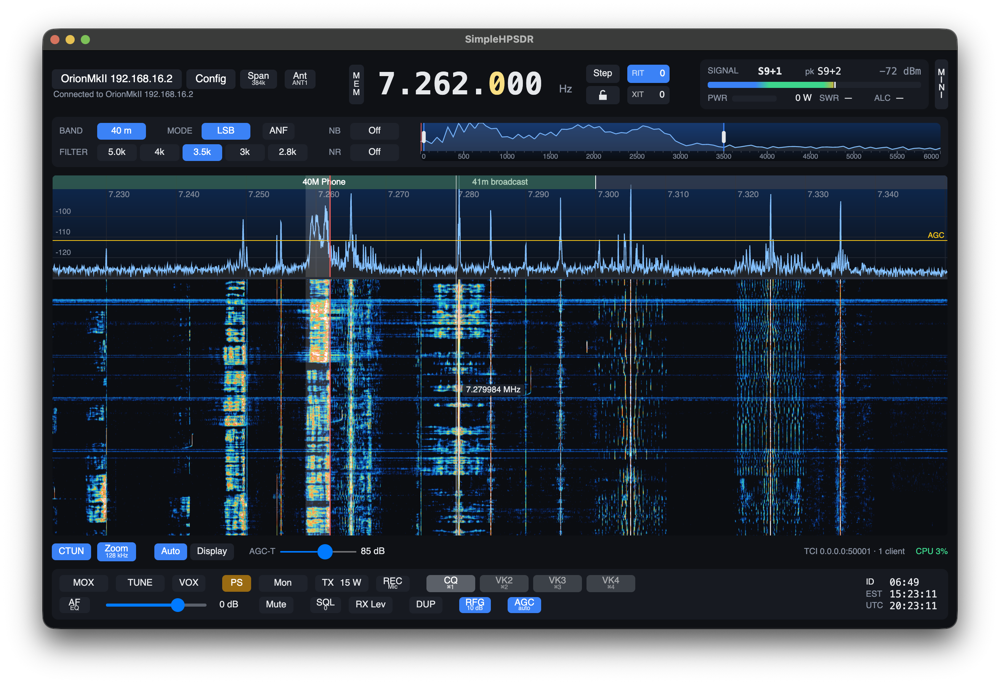
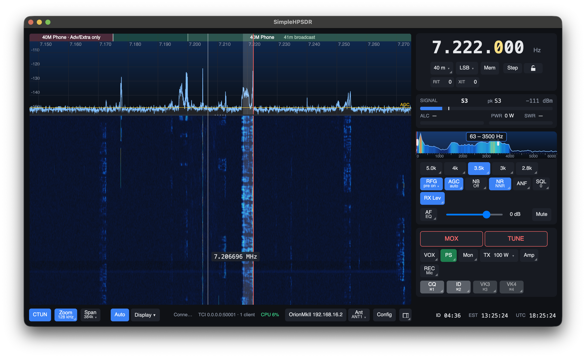
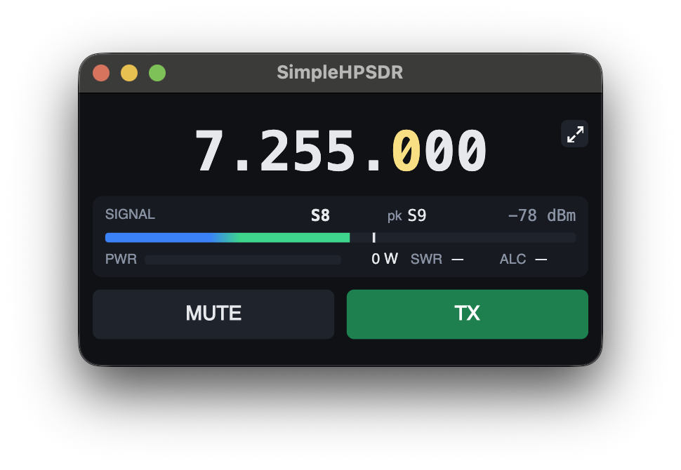
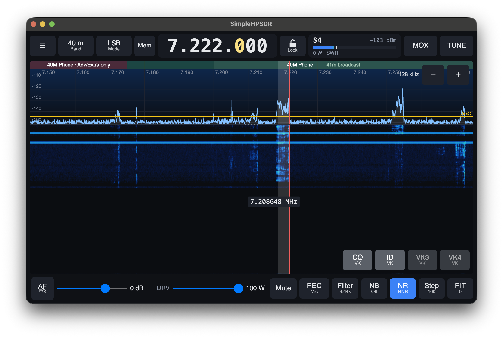

# SimpleHPSDR

A clean, simple interface for OpenHPSDR radios, my intention for this project
is "it's a radio". 

The everyday controls stay on screen and
the rest is a click or right-click away. As lean and clean an interface as
possible but allowing for all the functions of the supported hardware.

This radio has a TCI server so any loggers or digital mode software you choose
should integrate well. I have no intentions to integrate non radio functions into
this project.



The same controls can sit in a panel at the side instead, which gives the
panadapter the window's full height. The view button under the panadapter
switches between the two.



A lot of work has gone into reducing TX/RX latency in the turnover times, 
improving Pure Signal lock speed and function as well.

Developed on an ANAN 7000DLE MkII over Protocol 2. It also supports ANAN G2s
(including on the G2's own Pi), Hermes-Lite 2s and Brick SDRs. macOS and Linux
packages are available, and for Windows x64 an installer, with ASIO under Config > Audio.

Not affiliated with or endorsed by the Zeus SDR project.

## Features

- **Panadapter and waterfall:** drag to recentre, a zoom slider, an adjustable
  split between spectrum and waterfall, POP waterfall contrast, and a frequency
  readout that follows the pointer. Config > Colors picks the spectrum and
  waterfall colours.
- **Band strip:** along the top of the spectrum, from your band plan: green where
  your licence lets you transmit, red where it doesn't, grey for broadcast bands,
  CB and WWV.
- **Filter close-up:** 0 to 6000 Hz of received audio with draggable filter edges.
- **Two receivers, four slices:** RX1 and RX2 beside the frequency, each with
  its own panadapter and two slices (A1 and A2 on RX1, B1 and B2 on RX2). Every
  slice keeps its own mode, filter, noise settings and AGC; split and cross-band
  included. With more than one on, AF becomes a slider per slice (click a
  slice's label to mute it), and Pan puts RX1's slices in one ear and RX2's in
  the other (A1 and A2, while RX2 is off).
- **Band and mode memory:** each pair, such as 40 m DIGU, keeps its own
  frequency, filter, AGC, drive, mic gain and noise settings.
- **Memories:** 48 under Mem in three tabs, the same on every band, plus each band's own
  saved frequencies on a right-click of the band button.
- **Noise control:** NB1 and NB2, NR1 to NR4 and neural NNR, with their settings
  on right-click.
- **Receive:** a ten-band receive EQ on the AF button, adaptive squelch, the RX
  leveler, and preamp and attenuator steps with automatic attenuation.
- **Transmit:** PureSignal with one-button calibration and an IMD readout on
  two-tone, CFC, leveler, EQ, phase rotator, monitor and TX audio profiles.
- **Recorder and voice keyer:** REC, beside TX, records what you hear or your
  microphone, plays it back on the speakers or on the air, and four voice keyer
  buttons (also on the touch layout) each send a recording.
- **CW:** keyer settings, a CW window for sending from the keyboard with macros,
  and a decoder that shows the signal as text.
- **FreeDV RADE** digital voice, with your callsign sent at the end of each
  transmission and its squelch, mic and level settings on a right-click.
- **DRM** shortwave broadcasts, through the SimpleDream decoder.
- **Antenna analyser:** sweeps SWR across a band with the radio's own bridge
  at low power, a Hermes-Lite 2's built-in analyser or a NanoVNA.
- **Station:** CAT, TCI, antennas, band outputs, PA calibration, transverters,
  amplifier timing, the Hermes-Lite 2 and its N2ADR IO board, a Palstar HF-AUTO
  tuner's status, and backup and restore of all settings.
- **Clock and ID timer:** local time and UTC, and a reminder to give your call
  every ten minutes.
- **SWL:** starts in SAM with a station guide from EiBi, in your local time. Click a
  station to tune it.
- **Firmware loader** for Protocol 2 radios.
- **Two arrangements:** the controls above and below the panadapter, or all of
  them in a panel at its side so the panadapter gets the window's full height.
  The view button under the panadapter steps between them and the mini window;
  its right-click menu also has the touch layout.
- **Amp button:** says whether your amplifier is in line. On, Drive and Tune
  stop at the maximums you set for it; off, the radio runs to full power. Each
  keeps its own remembered levels, per band and per mode.
- **Mini window:** the view button under the panadapter (third click, or its right-click) shrinks
  SimpleHPSDR to the frequency, the meters, Mute and a TX button that transmits
  while held down. The arrows in its corner bring the full window back.
- **Light and dark themes**, following the system.

Most controls have more behind a right-click. See **Help** in the menu.



## What's New

### 0.15.3

- **RX2 works again on radios with only two receivers.** Since 0.15.0, RX2
  sat on the third receiver, which a Brick 3 (and other radios with two
  receivers) doesn't have: RX2's panadapter opened but stayed empty and
  silent. On those radios RX1 and RX2 now get one slice each, A1 and B1, as
  before 0.15.0.

### 0.15.2

- **No echo of your own voice after unkeying on another slice.** With
  PureSignal on and transmit on A2, B1 or B2, the last syllables of the
  transmission played back after unkey. Every receiver is now paused and
  cleared while you transmit, as it already was with PureSignal off.

### 0.15.1

- **CAT and TCI follow the transmitting slice.** With transmit on A2, B1 or
  B2, CAT and TCI programs now see split, with VFO B (TCI `vfo:0,1`,
  `tx_frequency`) on that slice's frequency. Amplifiers and tuners that follow
  the TX frequency over TCI or CAT now track it; before, they stayed on A1.
- The active slice's badge turns blue again when transmit moves to another
  slice.

### 0.15.0

- **Each receiver is its own:** RX1 and RX2 keep their own mode, filter, noise
  blanker and reduction, ANF and AGC. Before, they shared the filter and the
  noise and AGC settings. Squelch, RX Lev, RX EQ and the AM/FM options stay
  shared.
- **Two slices per receiver:** A1 and A2 on RX1's panadapter, B1 and B2 on
  RX2's. Add one from + in the touch drawer or the panadapter's right-click;
  they come on in order (A2, B1, B2). Each slice's small display shows its
  filter, NB/NR and AGC; click it to give that slice the controls. The old
  "slice B on RX1's panadapter" is now slice A2, and RX2 always has its own
  panadapter.
- **Per-slice mute:** click A1, A2, B1 or B2 beside the volume sliders.
- **PS CAL and 2-TONE** centre the transmitting slice and zoom to fit the tones,
  then put the display back.
- **With CTUN off the dial is always centred;** Center applies only with CTUN on
  and its slider is greyed out otherwise.

### 0.14.0

- **Ulanzi Dial (Mac):** a Ulanzi Dial (D100H, Bluetooth) works as a tuning knob
  and eight buttons, whichever window is in front. Turn it on in Config >
  Hardware. See Ulanzi Dial below.
- **Take over:** taking a radio over from another computer running SimpleHPSDR
  now makes that one let go. Before, both kept controlling the radio and its
  relays chattered. If the other program keeps running, the take-over is refused.
- **NNR noise reduction is faster,** by about a fifth on a Raspberry Pi and more
  than a third on Apple silicon, with the same sound.
- **Raspberry Pi:** the close-up's High resolution starts off, and Help has a
  section on keeping the load down (use NR2, not NNR).
- **Fixed:** with RX2 on and CTUN off, RX2's panadapter could not be dragged.
- **Updating tunes the signal processing once more** on the first start (a
  minute or two on a fast computer), except on a Raspberry Pi.

### 0.13.1

- **Raspberry Pi:** the first start no longer spends an hour or more tuning
  the signal processing; the package brings the tuning ready-made.
- **First start:** if you quit while it is tuning, it carries on from where it
  stopped next time (on Windows it starts again).

### 0.13.0

- **Two receivers:** RX1 and RX2 buttons beside the frequency pick the receiver
  the controls act on. RX2 opens its own panadapter, with a small VFO on each
  and a drag bar between them to share the room.
- **Pan slider:** with two receivers on, Pan under the two volume sliders puts
  them in different ears. It works on the computer's sound output.
- **48 memories:** Mem has three tabs, A, B and C, of 16 each. The memories you
  already have are in A.
- **Side panel width:** drag the panel's left edge to make it wider or
  narrower; double-click for the standard width.
- **Spectrum grid:** its colour and strength are in Config > Colors, and the dB
  lines get finer when you zoom in.
- **Filter close-up:** a line follows the mouse, with a flag showing the audio
  frequency.
- **Touch layout:** a View button for the desktop layout and the mini window,
  RX2 from the spectrum's menu, a keypad on the small VFOs, a volume slider for
  each receiver with Pan, and a DRV button that opens a larger drive slider.
- **A receiver on the Rx2 jack can transmit.**
- **Windows** comes as an installer only; there is no zip.
- **Fixed:** frequency markers went missing when a zoomed display was dragged
  to one side; a slice added on RX1's panadapter could come up silent; Mute ran
  past the edge of the side panel.

### 0.12

- **Two arrangements of the main window:** controls above and below the
  panadapter, or in a panel at its side. The view button steps between them.
- **Controls grouped by what they do,** and buttons show what they hide: a
  corner mark for a right-click, ▾ for a list.
- **Amp button:** Drive and Tune stop at the maximums you set for your
  amplifier, and it can switch an RF2K-S or one of the radio's outputs so the
  amplifier is in or out of line.
- **Drive is remembered for each mode** as well as each band.
- **Floor lift** in the Display popup raises the noise floor off the waterfall.
- **Slice B on the Rx2 jack,** with its own attenuator.
- **Automatic CW ID,** mixed into your voice transmissions.
- **6 m LNA button** on an ANAN G2.
- **A larger frequency readout at the pointer.**
- **Fixed in 0.12.1:** a crash when dragging the display with a manual notch
  on, a slow quit with an amplifier or logging program connected, and
  PureSignal going back to "Internal coupler" by itself.

### 0.11

- **Back to receive much sooner after you unkey,** with shorter timing
  defaults.
- **VOX delay is its own setting.**
- **PureSignal remembers its correction for each band,** and keeps adjusting
  from your voice. It stands still in CW.
- **Smoother audio while dragging the panadapter** with CTUN on.
- **Separate A and B volume sliders** while slice B is on (0.11.1).
- **Fixed:** mic gain changed with the mode; the Hermes-Lite 2 antenna analyser
  refused to sweep with the IO board; with CTUN on and zoomed in, the display
  slid when you clicked a frequency (0.11.1).

Each release's full notes are on the
[Releases](https://github.com/kingsqueak/SimpleHPSDR/releases) page.

## Install

Download a package from [Releases](https://github.com/kingsqueak/SimpleHPSDR/releases).

**macOS 14 or later:** open the DMG and drag SimpleHPSDR to Applications. The app
isn't signed by Apple, so the first time, run:

```sh
xattr -dr com.apple.quarantine /Applications/SimpleHPSDR.app
```

**Linux (x86-64 and arm64):**

```sh
sudo apt install ./simplehpsdr_*.deb        # Ubuntu 26.04, Debian
sudo dnf install ./simplehpsdr-*.rpm        # Fedora
sudo pacman -U ./simplehpsdr-*.pkg.tar.zst  # Arch
```

**Raspberry Pi OS Trixie or Bookworm (and Debian 13 or 12):** use the 64-bit
Raspberry Pi OS on a Pi 4 or Pi 5 (or a CM4 / CM5); the 32-bit edition can't run it. Download the `arm64` .deb from the
latest release (on a PC with x86-64 Debian 13, the `amd64` one), then in a terminal:

```sh
cd ~/Downloads
sudo apt update
sudo apt install ./simplehpsdr_*_arm64.deb
```

apt fetches anything else it needs. SimpleHPSDR is then in the applications menu
(or run `simplehpsdr`). To update, install the new .deb the same way; to
remove it, `sudo apt remove simplehpsdr`. Each release's debs are installed and
started on Debian 13 in CI. The first-start tuning below takes much longer on a
Pi than on a desktop computer, so leave it running.

**Windows 10 or 11 (x64), preview:** run `SimpleHPSDR-<version>-win-x64-setup.exe`.
It installs for you alone, with no administrator password, and adds SimpleHPSDR to
the Start menu and to Settings > Apps for uninstalling; for a new version, run its
setup. The .NET and Visual C++ runtimes are included. Settings are kept in
`%LOCALAPPDATA%\SimpleHPSDR`, so they carry over to new versions and stay if you
uninstall. The app isn't signed, so SmartScreen warns the first time:
choose More info, then Run anyway. If Windows Firewall asks about
`StationEngine.exe`, or asks to let it change your device, say yes, or the radio
won't be found. The rule is SimpleHPSDR's own, so Zeus on the same computer keeps
its rule. The radio picker's Network help button gives the command to add it by
hand, and if the picker finds nothing, it offers to add the rule again when none
exists.
To use ASIO, install your audio interface's driver, then pick ASIO under
Config > Audio. The driver must be able to run at 48 kHz. Fewer people use the
Windows build than the others, so please report what you find.

On macOS, allow SimpleHPSDR when it asks to find devices on your local network.

The first start takes a while. The signal processing is measured and tuned for your
computer, which takes around 8 minutes on a fast machine and longer on an older one.
A window shows the progress. Leave the app open until it finishes; this only happens
again after some updates. If you do quit, it carries on from where it stopped next
time (on Windows it starts again). A Raspberry Pi skips all this: its package brings
the tuning ready-made. SimpleHPSDR needs nothing from Zeus; everything it uses is in
the package.

Then choose your radio. Several radios report the same ID, so pick your model in
the radio picker or in Config > Radio. It sets the S-meter calibration and the PA
and PureSignal defaults.

## Small touch screens

On a screen narrower than 1080 pixels, such as the 1024x600 front panel of
some radios, SimpleHPSDR switches to a layout with large buttons and opens
full screen. The View button beside ☰ goes to the desktop layout or the mini
window, and the desktop view button's right-click menu comes back to it.
Config > Radio > Layout picks Automatic, Desktop or Touch;
`simplehpsdr --touch` or `--desktop` overrides it for one run. Everything in
it works with a mouse as well as a finger, and a long press does what a
right-click does.



To start it when a Raspberry Pi desktop logs in, create
`~/.config/autostart/simplehpsdr.desktop`:

```ini
[Desktop Entry]
Type=Application
Name=SimpleHPSDR
Exec=simplehpsdr
```

(Raspberry Pi OS also runs `~/.config/labwc/autostart`; a line `simplehpsdr &`
there does the same.) The touch layout has been tried with a mouse so far, and
the autostart steps aren't tested on a Pi yet; reports from touch-screen users
are welcome.

**Keeping the load down on a Pi.** When a Pi runs short of processor, the receive
audio clicks. Use NR2 for noise reduction, not NNR: on a Pi 5 at 192 kHz the
receiver's signal processing took about half of one core with NNR and about a
seventh with NR2. Leave the close-up's High resolution off (it starts off on a Pi).

**On an ANAN G2's own Pi** (CM4 or CM5, with its built-in screen and front
panel), SimpleHPSDR runs beside the G2's p2app: see [docs/g2-pi.md](docs/g2-pi.md).

## Ulanzi Dial (Mac)

A Ulanzi Dial (D100H, Bluetooth) works as a tuning knob and eight buttons, whichever
window is in front. Pair it with the Mac, tick "Use the dial" in Config > Hardware,
and allow SimpleHPSDR under Input Monitoring and Accessibility when macOS asks.
Ulanzi's own app is not needed. While SimpleHPSDR runs, the dial stops changing the
Mac's volume, sending media keys, typing and clicking; quit and it is its old self.

The three top buttons choose what a turn does: tune, volume or zoom. Pressing the
dial in while turning tunes ten steps at a time, a press mutes, and the side buttons
step the band and the mode. A careful turn tunes one step a click; a faster one
several; a spin glides on like a flick of the panadapter. Every control can be given
another job in Config, from the same list as the ANAN G2's front panel.

## Build

Requires the .NET 10 SDK.

```sh
git clone --recurse-submodules https://github.com/kingsqueak/SimpleHPSDR.git
cd SimpleHPSDR
scripts/build-engine.sh          # publishes the engine to artifacts/engine/<rid>
dotnet run --project src/SimpleHPSDR
```

`scripts/make-dmg.sh`, `scripts/make-linux.sh` and `scripts/make-windows.sh` build the packages; CI turns the Windows folder into an installer with `scripts/windows-installer.iss` (Inno Setup 6). Set
`SIMPLEHPSDR_ENGINE` to use an engine binary elsewhere.

The `external/station-engine` submodule follows
[kingsqueak/station-engine](https://github.com/kingsqueak/station-engine), a
permanent fork of the Zeus SDR project's Station Engine 2.0.68, tagged like
`v2.0.68-simplehpsdr.18`. It goes its own way: since `.18` it uses SimpleHPSDR's
names throughout (its projects, settings variables, files and native libraries),
so anything wanted from later Zeus releases, such as a new radio, is ported by
hand. Everything SimpleHPSDR doesn't use that served Zeus's web app, Zeus Link or
online services has been taken out (see `docs/engine-capabilities.md`). The
fork's own `Native libraries` workflow builds its miniaudio, RADE and ASIO
libraries for Linux and Windows, and WDSP for every packaged platform. Its changes also add
ADC dither and randomizer for the ANAN-7000DLE and 8000DLE
([#15](https://github.com/Zeus-SDR/station-engine/pull/15)), the G2 front-panel
CAT port ([#16](https://github.com/Zeus-SDR/station-engine/pull/16)), transverters
that work without Zeus's web app, and a data folder and firewall rule of the
engine's own (`STATION_ENGINE_DATA_DIR`, `STATION_ENGINE_FIREWALL_RULE`), so it
shares nothing with an installed Zeus.

Building the Mac app (`scripts/make-dmg.sh`) also compiles the dial's helper,
`tools/dial-helper/dial-helper.swift`, which needs Xcode's command line tools. For
a development run, build it once:
`swiftc -O tools/dial-helper/dial-helper.swift -o tools/dial-helper/dial-helper`.

## Firewalls

The radio uses UDP only, on radio ports 1024 to 1044 in both directions. This
computer's port is 1025 with Protocol 2 and random with Protocol 1, so allow the
`StationEngine` program rather than one port where your firewall can do that.

## Where things live

Settings, the engine's own database (separate from Zeus's) and `engine.log` are
in the app data folder, with the log from the previous start as `engine.previous.log`
and the engine's detailed log in `logs/simplehpsdr-app.log`:

- macOS: `~/Library/Application Support/SimpleHPSDR`
- Linux: `~/.local/share/SimpleHPSDR`
- Windows: `%LOCALAPPDATA%\SimpleHPSDR`

The engine's own files are there too: `wdspWisdom01`, the tuning file from that
first start, the LAN certificate and any noise reduction model you add. Nothing goes
to Zeus's folder. Versions before 0.7.2 kept the tuning file and models in a `Zeus`
folder beside that one; SimpleHPSDR copies them over once and leaves the old folder
alone.

## Credits

SimpleHPSDR stands on Station Engine, the radio and DSP engine from the Zeus SDR
project, whose principal developers are Douglas J. Cerrato, KB2UKA, and Christian
Suarez, N9WAR. WDSP is by Warren Pratt, NR0V. The firmware loader follows TAPR's
HPSDRProgrammer and deskHPSDR by Heiko Amft, DL1BZ.
DRM decoding is by DecDRM (GPL-2.0-or-later), through SimpleDream's bridge
(https://github.com/kingsqueak/SimpleDream), with FDK-AAC (Fraunhofer's licence),
Opus and libxaac; their licences are in the packages' drm-licenses folder.
The DeepCW CW decoder model is by e04 (https://github.com/e04/deepcw-engine, MIT
License), run with Microsoft's ONNX Runtime (MIT License).

## License

GPL-3.0-or-later. Station Engine, which the app runs and links, is
GPL-2.0-or-later.
