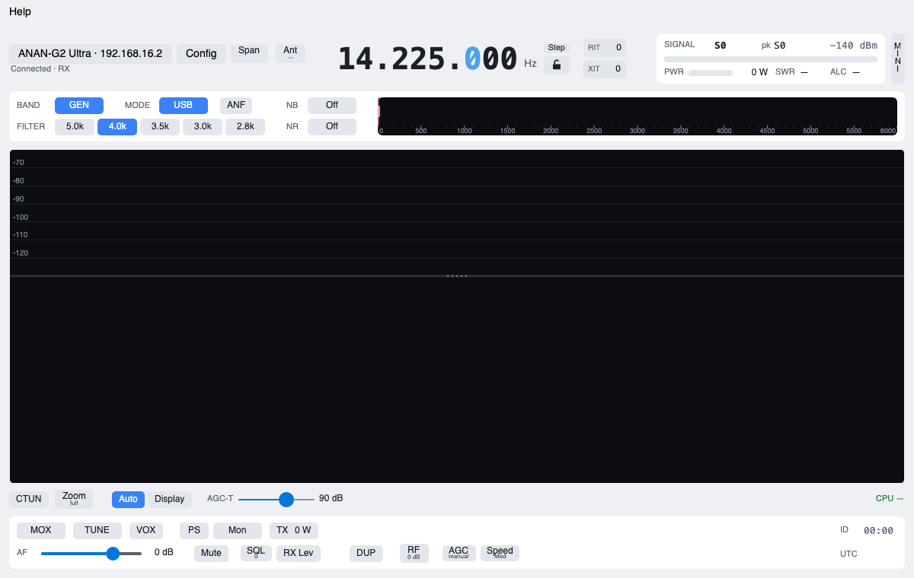
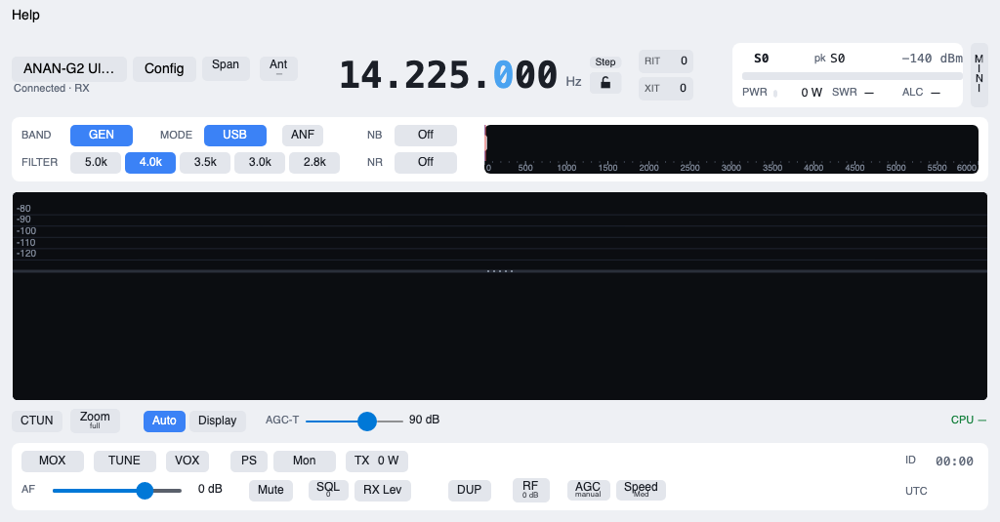
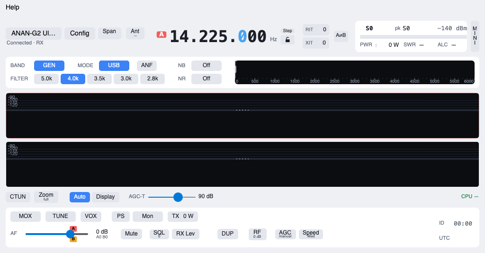
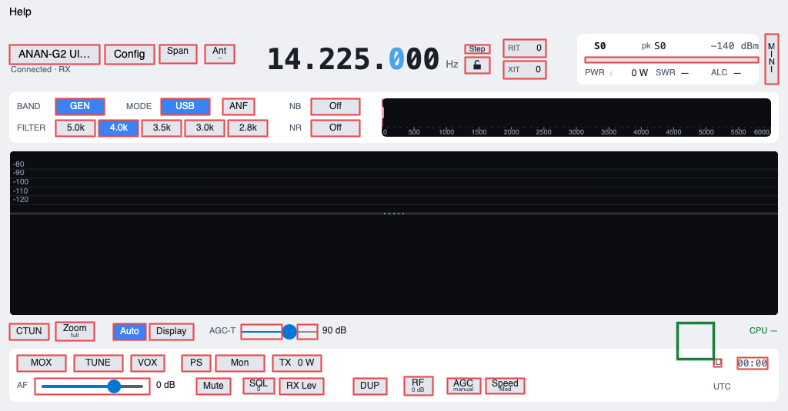
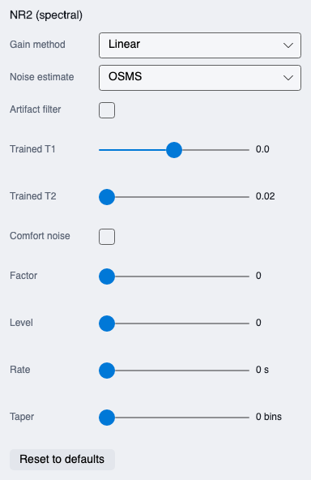
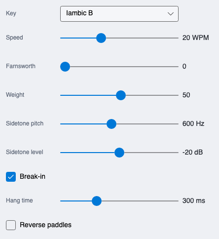
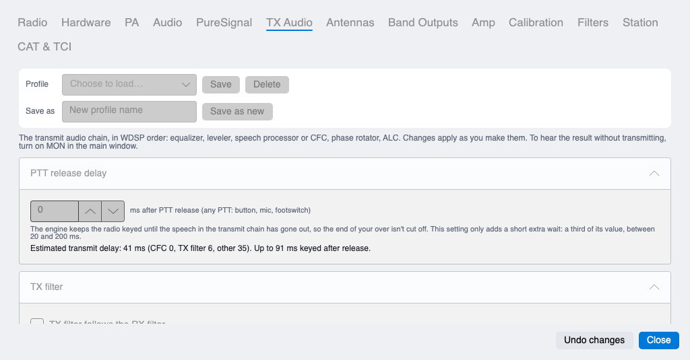
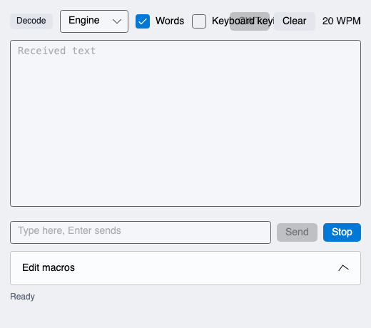
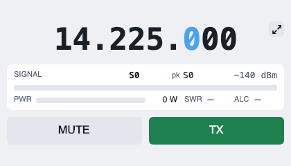
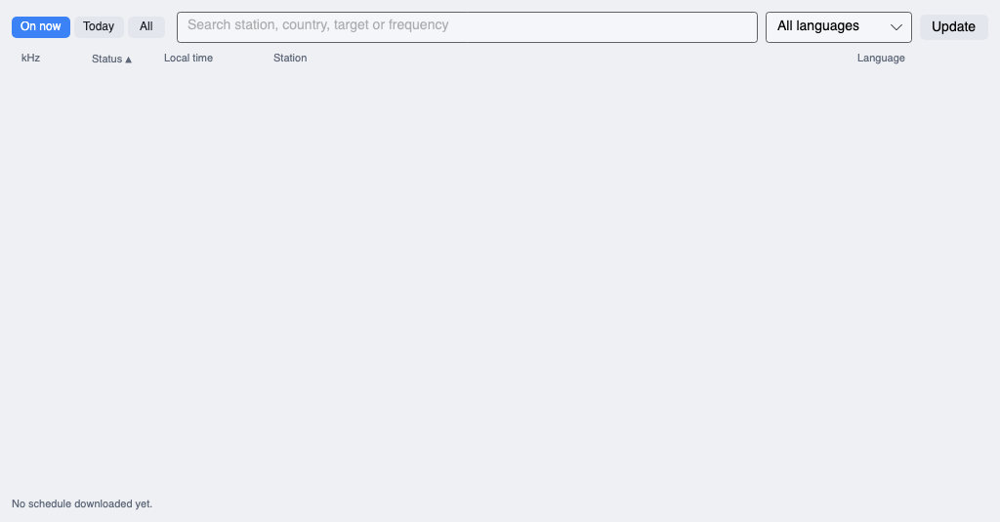

# SimpleHPSDR on a 1024×600 touch screen: plan

Status: plan only, 2026-11-08. No app code changed. Target: the front-panel
screen of radios such as the ANAN G2 Ultra (1024×600, touch), running the
arm64 deb on 64-bit Raspberry Pi OS Trixie. The desktop layout stays exactly as
it is; touch gets its own mode.

## How the screenshots were made

Every window was rendered off-screen with Avalonia's headless renderer (the
same drawing code as the real app, Linux-style in-window menu bar, no engine,
no radio, throwaway home folder). The main window was given a fake connected
state (14.225 MHz, five SSB filters) so the controls show as enabled. The same
tool measured every control's size and position. It lives outside the repo for
now (see Phase 1, "screenshot tool"). The pictures are in `docs/touch-plan/`.

Sizes used:

- **1024×535**: what a normal window gets on the Pi desktop (600 minus the
  taskbar and the title bar).
- **1024×600**: full screen, no taskbar or title bar (kiosk style).
- Physical size: on a 7-inch 1024×600 panel a pixel is about 0.15 mm, so a
  48 px button is about 7 mm, the usual minimum for a finger. Today's buttons
  are 22-26 px (3.5 mm).

## 1. Window audit

### Main window

Desktop size, for comparison (1200×760):



At 1024×535 (Pi desktop window):



**Good news: nothing clips.** The layout already squeezes correctly: the radio
name shortens, the S-meter narrows, everything else keeps its size, and the
panadapter shrinks to about 210 px tall (330 px less than desktop). With slice B
on, the two panadapters are about 95 px each, which is too small to use:



Problems:

| # | Problem | Where |
|---|---|---|
| M1 | `MinHeight="560"` is larger than the 535 px the Pi desktop gives a window. The window manager either refuses to shrink it or pushes the bottom row (MOX, TUNE, AF) under the taskbar. **Even a mouse user on the Pi hits this.** | `MainWindow.axaml:8` |
| M2 | Every control is too small for a finger: 43 hit targets under 40 px. Typical buttons are 22 px tall; the worst are Step (33×12), the ID dot (11×11), the MINI strip (18 px wide), lock (33×22), the AF trim flags (about 10 px). | red boxes below |
| M3 | Sliders are 22 px tall (squeezed by the `Margin="0,-14"` style), so the thumb is hard to catch and a drag often scrolls the wrong thing. | `MainWindow.axaml:14` |
| M4 | Panadapter is 210 px (one slice) or about 95 px each (two slices). The drag bar between spectrum and waterfall is 8 px to grab. | `SpectrumView.cs:34` |
| M5 | The filter close-up's edge handles are a few pixels wide and show only by changing the cursor. | `FilterScope.cs` |

Every red box is a control under 40 px; the green square is a 48 px target:



### Popups and flyouts (the boxes that open from buttons)

These were rendered one by one. Heights against the 535 px window (or 600 full
screen):

| Flyout | Size | Fits? |
|---|---|---|
| NR2 settings (right-click NR) | 384×592 | **No**: taller than the screen, bottom cut off |
| CW keyer (right-click WPM) | 444×484 | Only just, and only if it opens near the top |
| RX Leveler (right-click RX Lev) | 404×388 | Yes, but opens upwards from the bottom row, so it lands half off-screen unless Avalonia moves it |
| Filter edit (right-click a filter) | 324×211 | Yes; needs typing (numbers) |
| The rest (Ant, S-meter trim, ANF notches, Zoom, Display, VOX, PS, Mon, TX, SQL, RF) | under 240 tall | Yes |

Avalonia moves a popup to stay on screen but never adds a scroll bar, so
anything taller than the screen is cut off.

 

Inside the flyouts every slider, check box and drop-down is 20-32 px tall.

### Configuration window

`Width="1040"` is wider than the 1024 screen. At 1024 the tab strip wraps to
two rows (about 70 px), and the pages scroll. Pages are long (the Station page
is about 1,040 px of content, TX Audio about 820), so on a touch screen the
user scrolls a lot, which works (Avalonia's scroll areas pan with a finger).



Problems: S1 window wider than the screen; S2 tab text and number-box spinners
(about 34×30) small; S3 lots of typing (profile names, ports, callsign,
frequencies) with no keyboard on the radio; S4 the TX equaliser's curve drags
nodes (fine with a finger if the grab zone grows) and changes Q with the wheel
(no touch way).

### CW window

At its own default size (520×460) its top row overlaps: "Keyboard keying"
runs into Send/Clear because the row needs 620 px. **This is a desktop bug
too.** On touch it fits on the screen, but sending needs a keyboard, so on a
touch-only radio it's a receive/decoder window.



### Mini window

Already touch-friendly: everything scales with the window, and Mute and TX are
big. TX is momentary (press and hold), which works with a finger.



### Station guide

Fits at 1024×535. The station rows are two-line buttons about 40 px tall (OK).
The filter buttons (On now, Today, All) and column headers are small; the
search box needs a keyboard; a row's detail only shows as a tooltip (hover).



## 2. What depends on a mouse, and the touch way to do it

Background for each line: Avalonia tells the app which kind of pointer each
press came from (`Mouse`, `Touch` or `Pen`), so touch handling can be added
**only for touch presses** and the mouse keeps working exactly as today.

Avalonia 12 gestures (checked in the 12.1.5 package):

- **Tap, double-tap**: yes.
- **Long-press** (`Holding` event): yes, on by default for touch and pen.
  But a long-press does **not** open the right-click menus by itself
  (checked: raising `Holding` did not raise `ContextRequested`). One small
  global handler can turn a long-press into a right-click everywhere.
- **Pinch** (`PinchGestureRecognizer`, gives a scale factor): yes.
- **Swipe** and **scroll with inertia** (`ScrollGestureRecognizer`, the
  "keeps gliding after you let go" behaviour): yes; scroll areas already pan
  with a finger.
- **Drawer** (`SplitView`, and the new `DrawerPage`): yes.
- No "is there a touch screen" call. Detect it from the screen size, from the
  first touch press, or a setting.

| Today (mouse) | Code | Touch equivalent |
|---|---|---|
| **Wheel on the VFO** tunes by the step | `MainWindow.axaml.cs:30` | Drag sideways across the frequency: every ~20 px is one step, with a little inertia after a flick. |
| **Hover a digit + wheel** tunes that digit | `VfoDigitWheel.cs` | Touch a digit and drag up/down: that digit changes (like a thumbwheel). The touched digit lights up as hover does now. |
| **Click the VFO** to type a frequency | `MainWindow.axaml.cs:36` | Tap opens an **on-screen keypad** (0-9, ., kHz, MHz, ⌫, Enter), because the radio has no keyboard. |
| **Wheel on the panadapter** tunes by the step | `SpectrumView.cs:665` | Drag already pans; add a fling with inertia. Tap still tunes. |
| **Click** on panadapter tunes, **drag** pans | `SpectrumView.cs:630` | Works with a finger today (touch arrives as a left press). Keep. Raise the "is it a drag" threshold from 5 px to ~12 px for fingers, which wobble. |
| **Right-click on panadapter**: slice menu | `SpectrumView.cs:643` | Long-press. (This one checks the right button directly, so the global bridge doesn't reach it; it needs its own `Holding` handler.) |
| Zoom (button + right-click for span) | `MainWindow.axaml` Zoom | **Pinch** on the panadapter: spread to zoom in, pinch to zoom out. |
| Drag the bar between spectrum and waterfall | `SpectrumView.cs:34` (±4 px) | Grab zone ±16 px for touch. |
| Hover frequency tag on the panadapter | `SpectrumView.cs:350` | Show it while the finger is down and while dragging. |
| Drag filter edges in the close-up | `FilterScope.cs` | Grab zone ±16 px for touch; also ± buttons in the filter editor. |
| **Wheel on any slider** (1 unit per click) | `SliderWheel.cs` | Drag the thumb (works). Bigger thumb and track in touch mode; − / + buttons beside sliders where fine steps matter (AF, drive, mic gain). |
| AF slider: wheel; small A/B trim flags | `AfSlider.cs` | Drag works; trims get their own sliders in the drawer (the flags are ~10 px). |
| **RIT / XIT**: wheel 10 Hz, right-click clears | `MainWindow.axaml.cs:49-52` | Tap opens a small panel: On/Off, − / + 10 Hz, Clear. Long-press clears. |
| **WPM**: wheel sets speed, right-click keyer settings | `MainWindow.axaml.cs:53` | Tap opens the keyer panel with a speed slider and − / +. |
| **Right-click menus** (12 of them): band stack, mode options (AM/FM), DRM, SWL, ANF notches, filter edit, NB, NR, S-meter trim, Zoom span, VOX, PS, Mon, SQL, RX Lev | `ContextFlyout`s in `MainWindow.axaml`; band stack `MainWindow.axaml.cs:54` | Long-press opens the same menu (one global bridge). In the touch layout each also gets a visible ⚙ button in the drawer, because long-press is invisible: nobody guesses it. |
| Tooltips (hover) carry help such as "right-click to clear" | everywhere | No hover on touch. Touch mode hides "right-click" wording and relies on the drawer and the Help window. |
| Cursor shape shows drag areas | SpectrumView, FilterScope, AfSlider, EQ | No cursor on touch: draw visible handles (grip dots already exist on the split bar). |
| TX EQ: drag nodes, wheel changes Q | `ParametricEqView.cs` | Bigger grab zone; Q via pinch on a node or the row's own box. |
| Number boxes and text boxes (filter edges, ports, callsign, profile names, guide search, CW send) | flyouts, Config, guide, CW | Keypad for numbers (same one as the VFO). Words: the system on-screen keyboard, if it works with the app (see Phase 0); otherwise rare enough to do with a USB keyboard. |
| Popups close after 8 s without activity | `PopupTimeout.cs` | Keep; maybe 15 s in touch mode (finger moves only during contact, so it counts less activity). |
| CW keyboard keying (space, arrows) | `MainViewModel.CwKeyboard.cs` | Not offered on touch. |
| MOX / TUNE: one click keys | `MainWindow.axaml` | A brushed finger shouldn't key the transmitter. Touch mode: MOX and TUNE need a press of ~0.3 s (or press-and-hold for momentary, as in the mini window). |

## 3. Touch mode

### What it is

A second layout for the main window, chosen at start:

- **Setting**: Config > Radio > Layout (beside Theme): *Automatic*, *Desktop*, *Touch*.
  Default Automatic. Desktop and Touch are the manual override and always win.
- `--touch` / `--desktop` on the command line (or `SIMPLEHPSDR_LAYOUT=touch`)
  override the setting for that run, for a radio that starts the app at boot.

### Automatic: touch below 1080 px (user's decision, 2026-11-08)

**What it measures: the width of the screen's work area, not the window.**
The work area is the screen minus the taskbar/dock, in the app's own pixels
(after the system's display scaling, so a 4K laptop at 200 % counts as 1920
and stays desktop). Avalonia gives it as `Screens.ScreenFromWindow(window)
.WorkingArea` divided by that screen's `Scaling`.

- Work area narrower than 1080 → touch layout. The G2 Ultra (1024) and any
  1024×600 or 800×480 panel get touch; every normal monitor, and Mac laptops
  (1280 and up), get desktop.
- **Why not the window width:** the desktop window may be dragged down to
  900 wide today (MinWidth). If the window width decided, narrowing the window
  on a big monitor would suddenly swap the whole layout under the mouse, and
  dragging the edge back and forth across 1080 would flip it on every pass.
  The screen is what says "this is a small touch panel"; the window is just
  how the user arranged things.
- **Resizing the window across 1080:** no change. The desktop layout keeps
  squeezing as it does now; the touch layout stretches.
- **Dragging the window to another monitor:** the app checks again when the
  window lands on a different screen (on `PositionChanged`, once the screen
  under the window's centre changes and the window has stayed there for about
  a second, so passing over a monitor mid-drag doesn't switch). If the new
  screen is on the other side of 1080, the layout switches. The same view
  model is behind both layouts, so the radio state, slices and VFO carry over;
  only open popups close.
- **Screen changes while running** (a monitor unplugged, resolution changed):
  the same check, on Avalonia's `Screens.Changed`.
- **No pop-up question on the first touch.** A touch-screen laptop or monitor
  wider than 1080 stays in desktop layout unless the user picks Touch in
  Config; the touch gestures from Phase 2 still work there, because they follow
  the finger, not the layout.
- **Window size on switching:** touch opens full screen on its screen; going
  back to desktop restores the window's last desktop size and place.
- Config shows what Automatic chose: "Automatic (touch: this screen is 1024
  wide)", so a surprise is easy to explain.
- Touch mode opens **full screen** (no title bar, no taskbar), which gives the
  whole 1024×600, 65 px more than a window. A ✕/minimise button in the
  drawer replaces the title bar.

### Mouse first (user's constraint, 2026-11-08)

The user has no touch screen, so the touch layout is above all a
**large-target compact layout that a mouse drives completely**. Gestures are
extras for fingers; nothing may depend on one. Every action has a visible
button or a plain click, and is tested with the mouse on the Mac.

| Finger gesture | Mouse way (works in the touch layout too) |
|---|---|
| Long-press for a control's menu | Right-click, as today, **and** a visible ⚙ for each one in the drawer |
| Drag across the VFO / drag a digit | The same drag with the mouse button held; the wheel still works |
| Tap the VFO for the keypad | Click; the keypad buttons are clicked (a real keyboard also types into it) |
| Pinch to zoom the panadapter | Zoom − / + buttons beside the spectrum; Ctrl+wheel; on the Mac, the trackpad pinch (Avalonia reports it as `PointerTouchPadGestureMagnify`) |
| Fling the panadapter | Drag pans, as today (no glide needed) |
| Swipe the drawer shut | Click ☰ again, or click outside it |
| Long-press a band for the band stack | Right-click, and a "Stack" row in the band grid |
| Hold MOX/TUNE ~0.3 s (finger only) | A mouse click keys at once, as on desktop |
| Hover help (tooltips) | Tooltips stay for the mouse; touch layout adds visible ⚙/help |

**Testing on the Mac without a touch screen:**

- **Layout:** Config > Radio > Layout > Touch (or `--touch`) on the Mac, with the
  window set to 1024×600 and 1024×535. Everything gets clicked through with
  the mouse: every drawer tab, every picker and keypad, every former
  right-click menu. Automatic can't trigger on the Mac's screen (it's wider
  than 1080), which is why the manual override matters for testing.
- **Screenshot tool** (Phase 1) renders both layouts at both sizes and lists
  any target under 44 px and anything clipped: the automatic check on every
  change, and the desktop before/after comparison.
- **Automatic switching** (screen narrower than 1080): tested by giving the
  check a fake screen width in the headless tool, plus a quick real check on
  the Mac with display scaling set so the work area is under 1080 if macOS
  allows it.
- **Finger-only code** (long-press timing, pinch with two fingers, finger
  drag threshold): written as small functions with tests that feed them
  made-up pointer sequences, so the logic is checked without hardware. The
  Mac trackpad pinch exercises the same zoom code as a finger pinch.
- **What the Mac can't prove:** that touch actually reaches the app on a Pi
  under XWayland, and how gestures feel on glass. Those stay marked
  "untested on touch hardware" in the release notes until someone with a
  touch radio (a G2 Ultra owner) reports back. Since the mouse covers every
  action, a gesture that misbehaves there can't lock anyone out.

Because of this, the phases put the large-target layout ahead of the gestures.

### How the desktop layout stays untouched

Today the whole main window is written out in `MainWindow.axaml` with its event
wiring in `MainWindow.axaml.cs`. The plan is:

1. Move that layout, unchanged, into a `DesktopMainView` piece (a
   "UserControl": a reusable chunk of window). The main window shows it. The
   screenshot tool proves the desktop pixels didn't change.
2. Build a separate `TouchMainView`. Both views use the **same view model**
   (all the radio logic), so every feature behaves the same; only buttons and
   placement differ.
3. Big touch sizes come from a style set that only applies when the window
   carries a `touch` class (Avalonia styles work like CSS: one class on the
   window switches on a set of rules such as "buttons are 48 px tall"). Desktop
   windows never get that class.

### Compact layout (1024×600 full screen)

```
┌──────────────────────────────────────────────────────────────────────────────┐
│ ☰  │ 20m ▾ │ USB ▾ │   14.225.000   │ S9+10 ▮▮▮▮▮▮▮▯▯ │  MOX  │ TUNE │  64 px
├──────────────────────────────────────────────────────────────────────────────┤
│                                                                              │
│                      spectrum (tap tunes, drag pans,                         │
│                       pinch zooms, long-press: menu)                         │
│  ─ ─ ─ ─ ─ ─ ─ ─ ─ ─ ─ ─ ─ ─ ─ ─ ─ ─ ─ ─ ─ ─ ─ ─ ─ ─ ─ ─ ─ ─ ─ ─ ─ ─ ─ ─ ─ │ ~470 px
│                             waterfall                                        │
│                                                                              │
├──────────────────────────────────────────────────────────────────────────────┤
│ AF ━━━━━━━━●━━━━ │ Mute │ 2.8k ▾ │ NR2 │ NB │ Step 100 │ RIT │ A/B │  64 px
└──────────────────────────────────────────────────────────────────────────────┘
```

Everyday controls on screen: band, mode, VFO, S-meter, MOX, TUNE, AF, Mute,
filter, NR, NB, step, RIT, slice A/B. Buttons 48-56 px tall, at least 56 wide.
The meter shows one reading (S or, while keyed, PWR/SWR); tap it for the full
meter.

**☰ opens a drawer** (a panel that slides in over the left of the screen,
about 420 px wide, closed with a tap outside or a swipe) with tabs:

| Tab | Contents (today's place) |
|---|---|
| Receive | ANF + notches, NB/NR settings, SQL, RX Lev, AGC, RF/ATT/preamp, Span, Antennas, Zoom, Display, CTUN |
| Transmit | VOX, PS + two-tone/cal, Mon, TX drive/tune/mic, MON level |
| Slices | Slice B on/off, A⇄B, DUP, RIT/XIT detail, per-slice AF trims |
| Station | ID timer and clock, CW window, Station guide / SWL / DRM, Config, Help, Exit |

Band and mode pickers open as big grids (4 columns of 56 px buttons), not
menus. The band stack is a long-press on a band (and a "Stack" row in the band
grid). Flyouts in touch mode get a scroll area and a height limit so none runs
off the screen (fixes the NR2 panel).

Slice B in touch mode: one panadapter, with both slices' markers on it; tap a
marker to make that slice active. Two stacked panadapters don't fit.

## 4. Build plan (phases)

Each phase can be released on its own; the desktop look is checked unchanged
at every step with the screenshot tool.

### Phase 0: try it on the real screen (no code)

- Install the 0.6.0 arm64 deb on the G2 Ultra's Pi (or a Pi with a 1024×600
  touch screen). Check: does the window fit (M1)? Do taps arrive as touch?
  Trixie's desktop runs on Wayland (labwc) and Avalonia 12 draws through
  XWayland; touch should come through as X11 touch events, but this must be
  seen on the device. Run `xinput list` and `echo $XDG_SESSION_TYPE`.
- Frame rate and CPU with `SIMPLEHPSDR_STATS=1` (the panadapter at 1024 wide
  is fewer pixels than the desktop, but the Pi is much slower than the Mac).
- Does the system on-screen keyboard (squeekboard or wvkbd) pop up for the
  app's text boxes? Probably not through XWayland; that decides how much
  in-app keypad is needed.
- The G2 Ultra's own knobs and buttons: find out how they reach software
  (piHPSDR and Thetis support the G2 front panel). If they arrive as CAT
  commands, the app's CAT server may already cover tuning. This is a separate
  investigation, but a real VFO knob would take a lot of pressure off the
  touch VFO.
- Measure the panel (inches) to confirm the 48 px target size.

### Phase 1: groundwork (small, also good for desktop users)

**Done 2026-11-08 (uncommitted):** `tools/ui-shots`; main window MinHeight
500; CW window top row wraps; `Platform/ScreenFit.cs` (windows larger than
the screen shrink to it, popups taller than it scroll; the scroll part checked
headless, the window part only shows on a small screen); `Platform/LayoutMode.cs`
and Config > Radio > Layout with a status line, `--touch` / `--desktop` /
`SIMPLEHPSDR_LAYOUT`. Desktop screenshots unchanged before and after, except
the CW window and the new Layout row. The long-press bridge moved to Phase 3.

- **Screenshot tool** into `tools/ui-shots` (the headless renderer used for
  this plan): renders every window and flyout to PNG and lists small or
  clipped controls. Before/after comparison is the "desktop unchanged" proof.
- **M1**: let the main window go down to 500 px tall (the layout already
  copes; only the panadapter shrinks). A one-line change, invisible at normal
  sizes.
- **CW window**: fix the overlapping top row at its default width.
- **Config window**: never wider or taller than the screen it opens on.
- **Tall flyouts** get a scroll area and a maximum height (the screen's).
- **Layout setting** (Automatic / Desktop / Touch), `--touch`/`--desktop`,
  and the automatic check (work area narrower than 1080, re-checked on a
  screen change). Nothing uses it yet beyond reporting the choice in Config.

### Phase 2: the large-target layout (mouse-driven)

**Done 2026-11-08** (49dd2af, d7098f5, 34b337e, and the touch-sized panels):
DesktopMainView split out unchanged; TouchMainView with top and bottom
bars, pickers as button grids, frequency drag/wheel and keypad, AF and
drive sliders, zoom −/+ and Ctrl+wheel, a drawer with Receive, Transmit,
Slices and Station tabs; the desktop's settings popups shared through
MainResources.axaml; Full screen (automatic on a small screen); touch
styles in TouchStyles.axaml also size the shared panels' controls. Not
done: the filter close-up and slice B's own panadapter in the touch layout.

- Split `MainWindow` into `DesktopMainView` (unchanged) and the new
  `TouchMainView`; move the event wiring from `MainWindow.axaml.cs` into the
  views. This is the riskiest step: lots of wiring moves, so the screenshot
  comparison and a full desktop test on the radio come right after.
- Touch styles (`Window.touch`): 48 px buttons, thick sliders, big check
  boxes, bigger fonts in flyouts.
- Top bar, bottom bar, drawer with four tabs, band and mode grids, one
  panadapter with both slices.
- Full screen with its own exit.
- Keypad control (numbers, kHz/MHz, ⌫, Enter) for the VFO, reused for
  filter edges and number fields.
- VFO drag to tune and drag-a-digit (mouse button held, and later finger).
- RIT/XIT and WPM click panels with − / + buttons; Zoom − / + beside the
  spectrum and Ctrl+wheel.
- Bigger grab zones in this layout: spectrum/waterfall bar, filter edges.

All tested on the Mac by mouse at 1024×600 and 1024×535 (Layout: Touch).
This phase alone makes the app usable on a small screen with a mouse.

### Phase 3: finger extras

**Long press done 2026-11-08** (aaab70c): a half-second hold opens a
control's right-click menu in both layouts; the spectrum opens its slice
menu. Mouse holds count on buttons only. Still to do: finger drag
threshold, fling, pinch, MOX/TUNE press delay.

These take only touch presses. Checked on the Mac by trackpad pinch and by
tests that feed made-up pointer sequences (see "Mouse first").

- Long-press timing and the global long-press = right-click bridge for touch;
  the panadapter's long-press slice menu.
- Larger drag threshold for fingers; frequency tag while the finger is down.
- Panadapter fling with inertia; pinch to zoom (finger and Mac trackpad).
- MOX/TUNE press-to-key delay for touch presses.

Released marked "untested on touch hardware" until a touch-radio owner reports.

### Phase 4: the other windows and polish

- Config in touch mode: full screen, tabs down the left side in one column,
  48 px rows, keypad for numbers.
- Station guide: bigger filter buttons, tap a row to tune, long-press for the
  detail (today a tooltip).
- CW window: decoder only on touch (sending needs a keyboard).
- Start-at-boot recipe for the Pi (autostart entry with `--touch`) in the
  README.
- Help text: touch wording (long-press, pinch) when in touch mode.

### Rough size

Phase 1: a day. Phase 2: the big one, about a week and a half, mostly the
view split, the drawer and the keypad. Phase 3: one to two days. Phase 4: two
to three days. Phases 1, 2 and 4 are tested by the user with a mouse on the
radio; Phase 3 needs a touch-screen owner's report.

## Open questions for the user

1. Is the touch target the G2 Ultra's own panel (app running on the radio's
   built-in Pi), a separate Pi with a screen, or both?
2. Full screen in touch mode: OK to hide the Pi taskbar while it runs?
3. MOX/TUNE press delay on touch: wanted, or does it get in the way?
4. Slice B in touch mode: one panadapter with both markers, as proposed?
